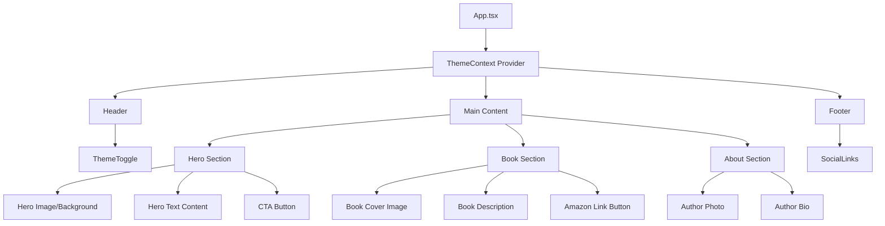

# Landing Page for Carlos Giron - Author Website

## Project Overview

A modern, dynamic landing page for author Carlos Giron to promote his book about "Paternidad" (Fatherhood). The site features a dark/light theme toggle and is built entirely in Spanish.

## Tech Stack

- **Framework**: React 18+ with Vite
- **Language**: TypeScript
- **Styling**: Tailwind CSS v3
- **Animations**: Framer Motion (optional) or CSS transitions
- **Icons**: Lucide React or React Icons
- **State Management**: React Context for theme management

## Project Structure

```
carlos_giron_v2/
├── public/
│   ├── favicon.ico
│   └── images/
│       ├── hero-bg.jpg
│       ├── book-cover.png
│       └── author-photo.jpeg
├── src/
│   ├── assets/
│   │   └── images/           # Imported images
│   ├── components/
│   │   ├── layout/
│   │   │   ├── Header.tsx
│   │   │   └── Footer.tsx
│   │   ├── sections/
│   │   │   ├── Hero.tsx
│   │   │   ├── Book.tsx
│   │   │   └── About.tsx
│   │   ├── ui/
│   │   │   ├── ThemeToggle.tsx
│   │   │   ├── Button.tsx
│   │   │   └── SocialLinks.tsx
│   │   └── index.ts
│   ├── context/
│   │   └── ThemeContext.tsx
│   ├── hooks/
│   │   └── useTheme.ts
│   ├── styles/
│   │   └── globals.css
│   ├── types/
│   │   └── index.ts
│   ├── App.tsx
│   ├── main.tsx
│   └── vite-env.d.ts
├── index.html
├── package.json
├── tailwind.config.js
├── tsconfig.json
└── vite.config.ts
```

## Component Architecture



## Theme System Design

### Color Palette

#### Dark Theme (Default)
| Element | Color | Tailwind Class |
|---------|-------|----------------|
| Background Primary | #0f172a | bg-slate-900 |
| Background Secondary | #1e293b | bg-slate-800 |
| Text Primary | #f8fafc | text-slate-50 |
| Text Secondary | #94a3b8 | text-slate-400 |
| Accent Primary | #3b82f6 | text-blue-500 |
| Accent Secondary | #60a5fa | text-blue-400 |

#### Light Theme
| Element | Color | Tailwind Class |
|---------|-------|----------------|
| Background Primary | #ffffff | bg-white |
| Background Secondary | #f1f5f9 | bg-slate-100 |
| Text Primary | #0f172a | text-slate-900 |
| Text Secondary | #475569 | text-slate-600 |
| Accent Primary | #2563eb | text-blue-600 |
| Accent Secondary | #3b82f6 | text-blue-500 |

### Theme Context Structure

```typescript
interface ThemeContextType {
  theme: 'dark' | 'light';
  toggleTheme: () => void;
}
```

## Section Specifications

### 1. Hero Section
- Full viewport height with background image
- Overlay for text readability
- Book title prominently displayed
- Tagline/subtitle
- CTA button linking to book section or Amazon
- Smooth scroll behavior

### 2. Book Section
- Book cover image (portada2.png or portada paternidad.jpeg)
- Book title and description in Spanish
- Key features or highlights
- Prominent "Comprar en Amazon" button
- Placeholder for Amazon affiliate link

### 3. About the Author Section
- Author photo (foto Carlos Giron .jpeg)
- Bio text in Spanish
- Professional background
- Personal touch about fatherhood journey

### 4. Footer Section
- Social media icons with links (placeholders)
- Copyright notice
- Theme toggle (optional duplicate)
- Contact email (optional)

## Responsive Breakpoints

| Breakpoint | Width | Target Devices |
|------------|-------|----------------|
| sm | 640px | Mobile landscape |
| md | 768px | Tablets |
| lg | 1024px | Small laptops |
| xl | 1280px | Desktops |
| 2xl | 1536px | Large screens |

## Animation Strategy

- **Entrance animations**: Fade-in on scroll using Intersection Observer
- **Theme transition**: Smooth color transition (300ms ease)
- **Hover effects**: Scale and shadow on buttons/cards
- **Scroll behavior**: Smooth scroll for anchor links

## Implementation Phases

### Phase 1: Project Setup
1. Initialize Vite + React + TypeScript project
2. Install and configure Tailwind CSS
3. Set up project folder structure
4. Configure path aliases in tsconfig

### Phase 2: Core Infrastructure
1. Implement ThemeContext with localStorage persistence
2. Create base UI components (Button, ThemeToggle)
3. Set up global styles and Tailwind configuration
4. Import and optimize images

### Phase 3: Section Components
1. Build Hero section with responsive design
2. Build Book section with Amazon link placeholder
3. Build About section with author content
4. Build Footer with social links placeholders

### Phase 4: Polish & Optimization
1. Add animations and transitions
2. Test responsive design across breakpoints
3. Verify theme switching functionality
4. Performance optimization (image lazy loading, etc.)

## Content Placeholders

### Spanish Content Structure

```typescript
const content = {
  hero: {
    title: "Paternidad",
    subtitle: "Un viaje de amor, aprendizaje y crecimiento",
    cta: "Descubre el libro"
  },
  book: {
    title: "Sobre el Libro",
    description: "Una guía reflexiva sobre el viaje de ser padre...",
    buyButton: "Comprar en Amazon"
  },
  about: {
    title: "Sobre el Autor",
    bio: "Carlos Girón es un apasionado escritor..."
  },
  footer: {
    copyright: "© 2026 Carlos Girón. Todos los derechos reservados."
  }
};
```

## Social Media Icons (Placeholders)

- Instagram
- Twitter/X
- Facebook
- LinkedIn
- TikTok (optional)

## Assets to Use

From the Uploads folder:
- `foto Carlos Giron .jpeg` - Author photo for About section
- `portada paternidad.jpeg` - Book cover
- `portada2.png` - Alternative book cover
- Design reference images for styling guidance

## Next Steps

1. **User Approval**: Review this plan and confirm or request changes
2. **Switch to Code Mode**: Implement the project
3. **Provide Content**: User will provide Amazon link and social media links during implementation
